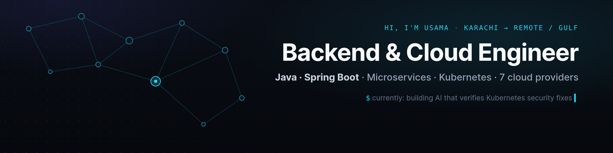

### Hi, I'm Usama 👋

I'm a backend & cloud engineer. For 3+ years I've built Java/Spring Boot microservices for **Cloud 7**, a multi-cloud management and billing platform integrated with **seven cloud providers**: AWS, Azure, Huawei Cloud, Alibaba Cloud, OpenStack, VMware and Red Hat OpenShift.

- 🔧 **Work:** REST APIs and microservices, cloud provisioning (VMs, VPCs, load balancers, security groups), Kubernetes/OpenShift automation, Keycloak SSO, CI/CD
- 🎓 **Research:** MS CS at FAST-NUCES. My thesis verifies LLM-generated Kubernetes security fixes with attack graphs and live deployment tests
- 🏅 BSCS Gold Medalist (MAJU)
- 🌍 Based in Karachi · open to remote and Gulf (UAE / KSA) roles

**Stack**

`Java` `Spring Boot` `Spring Security` `Hibernate/JPA` `MySQL` `MongoDB` `Redis` `Kafka`
`Kubernetes` `OpenShift` `Docker` `Jenkins` `GitHub Actions` `Ansible` `Keycloak`
`AWS` `Azure` `Huawei Cloud` `Alibaba Cloud` `OpenStack` `VMware` · `Python` `LLM agents` `RAG`

**Selected work**

| Project | What it is |
|---|---|
| [dijkstra-vs-sssp-research](https://github.com/theUsamasaleem/dijkstra-vs-sssp-research) | Benchmarked Dijkstra, Bellman–Ford, SPFA and A* on graphs of up to 1M vertices; IEEE-format paper |
| [gitops](https://github.com/theUsamasaleem/gitops) | Spring Boot service packaged with Docker, the base for a GitOps deployment pipeline |

📫 [LinkedIn](https://www.linkedin.com/in/theusamasaleem) · usamathesaleem@gmail.com
